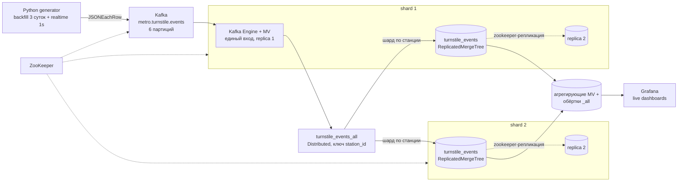

# Аналитика загруженности метро Москвы в реальном времени

Итоговый проект курса «ClickHouse для инженеров и архитекторов БД».

Тема работы показать одну из областей применения ClickHouse для онлайн аналитики данных.
Практически онлайн обновление данных в витринах позволяет принимать оперативные решения.
Для формирования исходных данных применяется генератор, который близко к реальным данным симулирует 
проходы пассажирова через турникеты и вход в вагоны. Предполагается, что в реальном мире входы\выходы в метро 
будут реализованы через компьютерное зрение.
Данные на стороне аналитической системы принимаются из Kafka с помощью Kafka engine + материализованные
представления. Далее через MV формируются агрегаты и на стороне Grafana формируется дашборд.

## Запуск

```bash
cp .env.example .env   # поменять пароли при необходимости
docker compose up -d
```

После старта в течение нескольких минут генератор выдает данные за t-3 и начинает отправлять онлайн 
данные с периодичностью в 1с.

- Grafana: http://localhost:3000 (admin, пароль из `.env`), дашборд «Метро Москвы — live»  

- ClickHouse доступен снаружи: шард 1 `8123/9000`, шард 2 — `8124/9001`.
  Для внешних запросов заводил отдельного read-only пользователя `reader`, пароль также в `.env`

```bash
curl "http://localhost:8123/?query=SELECT+count()+FROM+metro.turnstile_events_all" --user reader:пароль
```

Скрипты из `clickhouse/init` ClickHouse прогоняет при первом старте, монтируются в 
/docker-entrypoint-initdb.d.
Если схему надо пересобрать файл `00_drop_all.sql` удаляет все объекты в обратном порядке
(MV приёмника → агрегаты → факт → словари → справочники), дальше 01-06 поднимают заново.

## Архитектура



ZooKeeper один для Kafka, и для кластера ClickHouse. 

Приём данных. Kafka-таблица `kafka_events` и приёмный MV раскатаны только на
ch-shard1-r1.

Агрегаты для дашбордов считаются, в MV: `station_load_1m` и `line_load_1m` —
пассажиры в минуту по станции/линии и направлению; `train_load_1m` — дельта +1/−1 по
поезду и минуте. 

Генератор моделирует поездки. Вход — это посадка в конкретный ближайший поезд по расписанию линии, выход происходит позже, на другой станции, тем же поездом. Благодаря этому в поезде можно посчитать текущую заполняемость.

Ёмкость поезда хранится в справочнике  `trains` (вагоны, вместимость вагона). Суточный профиль с пиками 8–10 и 17–19, центр станции оживлённее окраин,
1.5 млн посадок в сутки (примерно вдвое больше событий с учётом выходов), пиковая
заполняемость поездов получается 45–50%.

## Grafana

Дашборд `metro-live` (10-секундный refresh): поток входа по станциям и линиям,
geomap по координатам (размер/цвет круга — последние 5 минут), топ-12 станций,
заполняемость поездов таблицей и пик load factor. Везде Distributed + dictGet
вместо join к справочникам.
